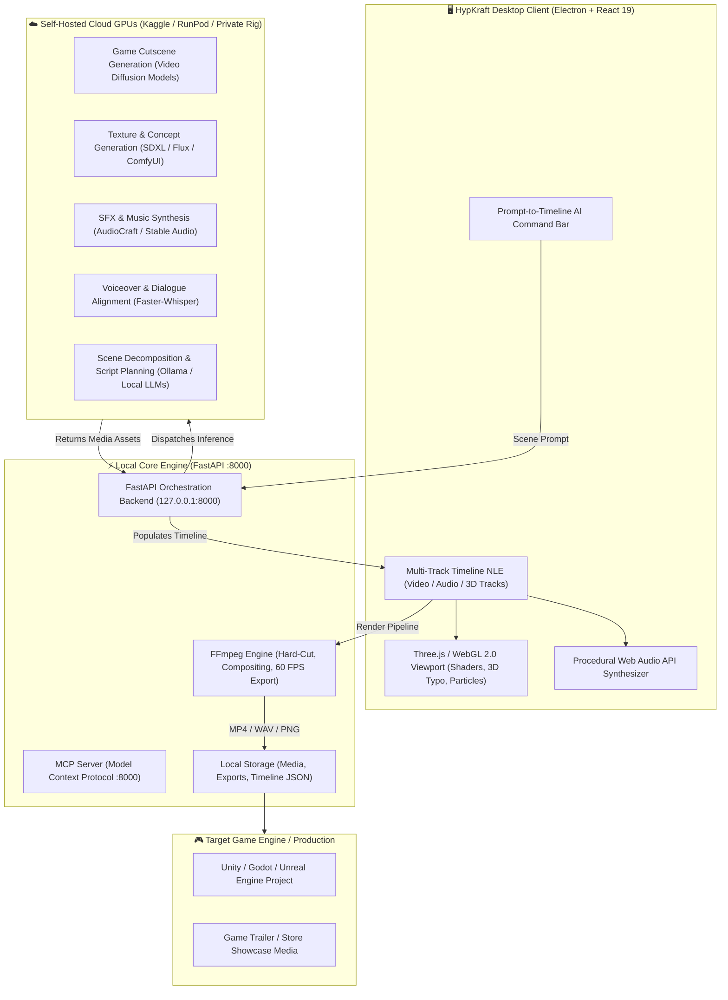
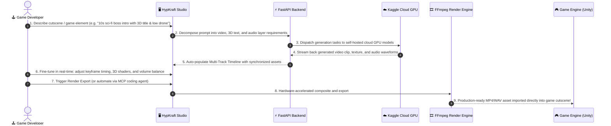

<div align="center">


# HypKraft Studio

### Internal Game Asset & Cutscene Pipeline Tool
**Built for WebSpider Studios • Game Cutscenes, 3D Motion, Audio SFX & Concept Assets**

[](https://hypkraft.webspiderstudios.com)
[](https://hypkraft.webspiderstudios.com)
[](https://hypkraft.webspiderstudios.com)
[](https://hypkraft.webspiderstudios.com)
[](https://hypkraft.webspiderstudios.com)
[-pink.svg?style=for-the-badge)](LICENSE.md)

**Maintained by:** WebSpider Studios &bull; [vivekanandrajbhar.link](https://vivekanandrajbhar.link)

---

</div>

## 🎮 Why This Tool Exists

When developing indie games at **WebSpider Studios** (such as *Drone Crash Game* and *Aqua-Sort*), creating narrative cutscenes, promotional game trailers, 3D animated title screens, and custom sound effects presents a massive bottleneck for a solo developer or small team. Commercial software suites are fragmented, and paying subscription fees for separate cloud AI services quickly becomes unsustainable.

**HypKraft Studio** was built as an internal desktop pipeline tool to solve this exact problem: a single, unified workstation that connects to our own **self-hosted AI models running on cloud GPUs (such as Kaggle and RunPod)** to generate, assemble, and render the multimedia elements required for game production:

* 🎬 **Game Cutscenes & Trailer Clips:** Compose cinematic video shots, story sequences, and promo teaser clips directly onto an interactive multi-track timeline.
* 🖼️ **2D Concept Textures & Backgrounds:** Generate environment backdrops, UI concept art, and texture reference plates via self-hosted diffusion pipelines.
* 🔊 **Procedural Game Audio & SFX:** Generate audio stems, Foley effects (whooshes, impacts, engine drones, UI clicks), and real-time Web Audio API waveforms at 48 kHz.
* 🧊 **3D Title Typography & Motion UI:** Real-time Three.js / WebGL 2.0 viewport for extruded 3D kinetic text, GLSL particle shaders, and animated logo reveals for game menus and intro sequences.
* ⚡ **Multi-Track Timeline Compositing:** Layer video, audio, and 3D graphics with non-linear editing (hard-cuts, cross-fades, keyframe timing) and export final 60 FPS video via FFmpeg.
* ☁️ **Self-Hosted Cloud GPU Infrastructure:** Keeps development costs at zero by offloading heavy inference to personal cloud GPU instances (Kaggle / RunPod / private rigs) via secure API tunnels.
* 🤖 **Model Context Protocol (MCP) Integration:** Exposes timeline state and editing tools on port 8000, allowing local coding assistants (Claude Desktop, Cursor, Antigravity) to script scene generation and asset placement programmatically.

---

## 🗺️ System Architecture (How It Works)



---

## 🎬 Studio Workflow (How We Use It To Build Game Elements)



---

## 🚀 Running HypKraft Studio Locally

HypKraft Studio is structured for straightforward local operation:

1. **Clone the Repository:**
   ```bash
   git clone https://github.com/VR-WebSpider/HypKraft-Studio.git
   cd HypKraft-Studio
   ```

2. **One-Click Studio Launch:**
   Run the startup script:
   ```cmd
   start_studio.bat
   ```
   This initializes:
   * **FastAPI Backend & MCP Server:** `http://127.0.0.1:8000`
   * **Vite / React 19 UI:** `http://localhost:5173`
   * **Interactive API Docs:** `http://127.0.0.1:8000/docs`

3. **Configure Self-Hosted Cloud GPU Endpoints:**
   In your `.env` (or via the in-app Settings modal), point your model endpoints to your self-hosted Kaggle/RunPod tunnels or local GPU server:
   ```env
   # Self-Hosted Cloud GPU / Local Endpoints
   OLLAMA_URL=http://localhost:11434
   COMFYUI_URL=http://your-kaggle-tunnel:8188
   AUDIOCRAFT_URL=http://your-cloud-gpu:8001
   WHISPER_URL=http://your-cloud-gpu:9000
   ```

---

## 🤖 Model Context Protocol (MCP) Server

HypKraft Studio runs an internal MCP server allowing external AI agents to manipulate the timeline.

### Agent Configuration (`claude_desktop_config.json`):
```json
{
  "mcpServers": {
    "hypkraft-studio": {
      "command": "python",
      "args": ["services/mcp_server.py"],
      "env": {
        "HYPKRAFT_STUDIO_URL": "http://127.0.0.1:8000"
      }
    }
  }
}
```

### Available MCP Tools:
| Tool Name | Action |
|---|---|
| `hypkraft_get_project_state` | Retrieves project timeline, tracks, playhead, and active clip states. |
| `hypkraft_execute_prompt` | Executes natural language prompt to generate or modify timeline clips. |
| `hypkraft_add_clip` | Inserts a video, image, audio, or 3D graphic clip to a specific track. |
| `hypkraft_split_clip` | Splits a clip at a given timestamp. |
| `hypkraft_render_export` | Initiates video export rendering via FFmpeg engine. |

---

## 🔒 Privacy & Local Execution

- **Local Storage First:** All project timelines, media cache, and rendered cutscenes stay strictly on your local machine.
- **Isolated Network Footprint:** The backend server and MCP endpoints bind exclusively to `127.0.0.1` (localhost loopback).
- **Self-Hosted AI Control:** Connects to your own self-hosted cloud or local GPU instances, guaranteeing complete privacy and zero vendor lock-in.

---

## 📄 Documentation & License

- **Source-Available License:** [LICENSE.md](LICENSE.md) *(Non-commercial & evaluation license for WebSpider Studios)*
- **End User License Agreement:** [EULA.md](EULA.md)
- **User Guide:** [USER_GUIDE.md](USER_GUIDE.md)
- **Security Policy:** [SECURITY.md](SECURITY.md)

---

<div align="center">
  <p>© 2026 WebSpider Studios. Internal Game Development Tooling.</p>
</div>
