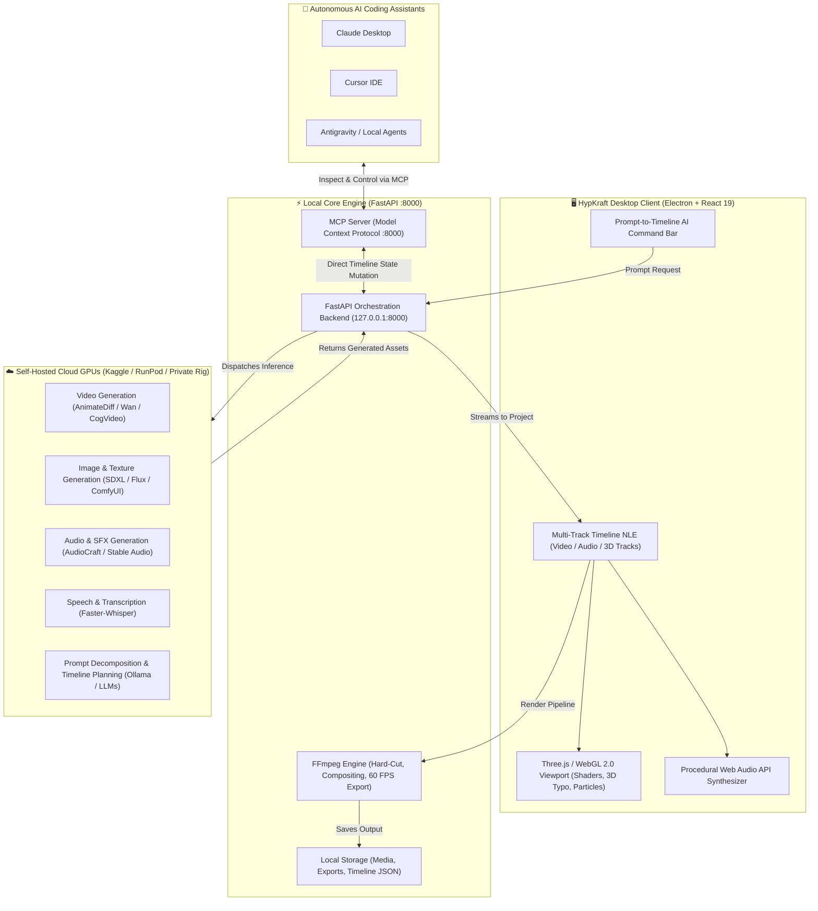
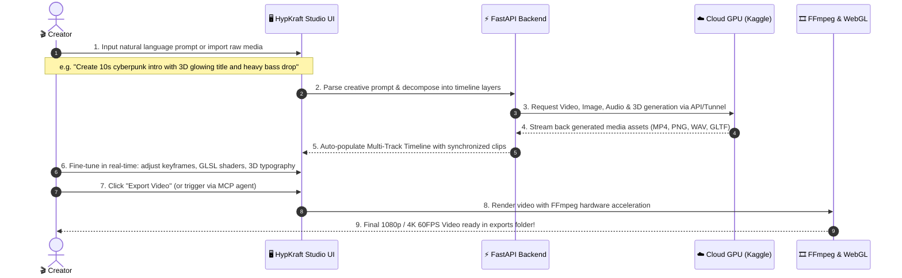

<div align="center">


# HypKraft Studio

### Personal & Experimental Multi-Tool Creative AI Suite
**AI Video • Image • Audio • 3D Assets • Motion & Animation Engine**

[](https://hypkraft.webspiderstudios.com)
[](https://hypkraft.webspiderstudios.com)
[](https://hypkraft.webspiderstudios.com)
[](https://hypkraft.webspiderstudios.com)
[](https://hypkraft.webspiderstudios.com)
[-pink.svg?style=for-the-badge)](LICENSE.md)

**Official Web Portal & Download Hub:** [https://hypkraft.webspiderstudios.com](https://hypkraft.webspiderstudios.com)  
**Maintained by:** WebSpider Studios

---

</div>

## 🌟 Overview

**HypKraft Studio** is a personal and experimental creative workstation that bridges conversational generative AI with professional multi-track Non-Linear Editing (NLE). 

Rather than producing isolated, uneditable video clips, HypKraft connects to your own self-hosted AI models running on cloud GPUs (such as **Kaggle**, **RunPod**, or local GPU instances) to generate and compose complete, layer-by-layer creative timelines:

* 🎬 **AI Video Generation:** Generate dynamic clips and prompt-guided cinematic video sequences directly placed into multi-track video layers.
* 🖼️ **AI Image & Concept Generation:** Create visual concept art, background plates, textures, and style frames on demand.
* 🎵 **AI Audio & Procedural Sound Design:** Synthesize musical stems, Foley sound effects, ambient pads, and Web Audio API waveforms at 48 kHz 32-bit float precision.
* 🧊 **3D Asset Generation & Motion Graphics:** Real-time Three.js & WebGL 2.0 viewport featuring GLSL motion shaders, extruded 3D kinetic typography, and 3D particle nebulas.
* ⚡ **Motion & Animation Engine:** Keyframe curves, camera pans, and procedural transitions for dynamic pacing and visual storytelling.
* ☁️ **Self-Hosted Cloud GPU Integration:** Connects seamlessly to your personal self-hosted cloud GPUs (e.g., Kaggle GPU environments running ComfyUI, Ollama, Whisper, or custom diffusion backends) via secure tunneling, keeping inference private, flexible, and completely under your control.
* 🤖 **Model Context Protocol (MCP):** Embedded MCP server on port 8000 allowing autonomous AI coding assistants (Claude Desktop, Cursor, Antigravity) to inspect clips, manipulate layouts, and trigger video exports headlessly.

---

## 🗺️ How Exactly It Works (System Architecture)



---

## 🎨 How to Use This Tool (User Creative Workflow)



---

## 🚀 Quick Start (Running HypKraft Studio)

HypKraft Studio is pre-configured with zero prerequisites for end-users:

1. **Clone the Repository:**
   ```bash
   git clone https://github.com/VR-WebSpider/HypKraft-Studio.git
   cd HypKraft-Studio
   ```

2. **One-Click Studio Launch:**
   Run the setup batch script:
   ```cmd
   start_studio.bat
   ```
   This automatically initializes:
   * **FastAPI Backend & MCP Server** on `http://127.0.0.1:8000`
   * **Vite / React 19 Frontend** on `http://localhost:5173`
   * **Interactive API Documentation** on `http://127.0.0.1:8000/docs`

3. **Connect to Your Self-Hosted Cloud GPUs:**
   In your `.env` (or via the in-app Settings modal), point your model endpoints to your local or cloud GPU instances:
   ```env
   # Self-Hosted Cloud GPU / Tunnel URLs (e.g. Kaggle / RunPod / Ngrok)
   OLLAMA_URL=http://localhost:11434
   COMFYUI_URL=http://your-kaggle-or-cloud-tunnel:8188
   AUDIOCRAFT_URL=http://your-cloud-gpu:8001
   WHISPER_URL=http://your-cloud-gpu:9000
   ```

---

## 🤖 Model Context Protocol (MCP) Server

HypKraft Studio runs an internal MCP server allowing external AI agents to manipulate the timeline.

### Agent Configuration (`claude_desktop_config.json`):
```json
{
  "mcpServers": {
    "hypkraft-studio": {
      "command": "python",
      "args": ["services/mcp_server.py"],
      "env": {
        "HYPKRAFT_STUDIO_URL": "http://127.0.0.1:8000"
      }
    }
  }
}
```

### Available MCP Tools:
| Tool Name | Action |
|---|---|
| `hypkraft_get_project_state` | Retrieves project timeline, tracks, playhead, and active clip states. |
| `hypkraft_execute_prompt` | Executes natural language prompt to generate or modify timeline clips. |
| `hypkraft_add_clip` | Inserts a video, image, audio, or 3D graphic clip to a specific track. |
| `hypkraft_split_clip` | Splits a clip at a given timestamp. |
| `hypkraft_render_export` | Initiates video export rendering via FFmpeg engine. |

---

## 🔒 Privacy & Architecture Notes

- **Local-First Storage:** Project timelines, cache, and exported media files remain on your local disk.
- **Loopback Isolated:** The backend server and MCP endpoints bind exclusively to `127.0.0.1` (localhost), ensuring external networks cannot access your editing session without your authorization.
- **Self-Hosted AI Flexibility:** All creative generation pipelines are modular and connect to your own self-hosted cloud or local GPU instances, guaranteeing complete privacy and zero third-party subscription lock-in.

---

## 📄 Legal & Documentation Links

- **Full User Manual:** [USER_GUIDE.md](USER_GUIDE.md)
- **Source-Available License:** [LICENSE.md](LICENSE.md)
- **End User License Agreement:** [EULA.md](EULA.md)
- **Security Policy:** [SECURITY.md](SECURITY.md)
- **Official Portal:** [https://hypkraft.webspiderstudios.com](https://hypkraft.webspiderstudios.com)

---

<div align="center">
  <p>© 2026 WebSpider Studios. Experimental Creative AI Workstation.</p>
</div>
